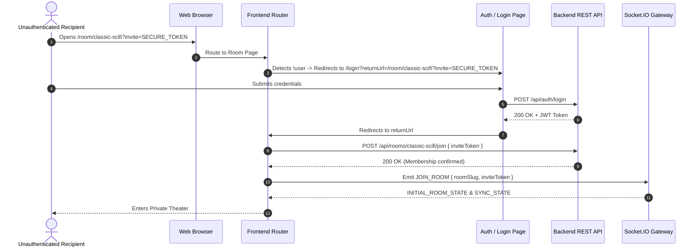

# SYNCTHEATER: Private Rooms & Production Invitation Link Implementation Report

> **Phase Execution Status:** Complete & Fully Verified  
> **Backend Test Suite:** 51 / 51 Passing (9 test suites)  
> **Frontend Test Suite:** 30 / 30 Passing (5 test suites)  
> **Total Test Suite:** 81 / 81 Passing  
> **TypeScript Compilation:** 0 Errors (Backend & Frontend)

---

## 1. Architectural Changes

### 1.1 Strict Private Room Enforcement
- **Universal Private Default:** All newly created rooms are strictly set to `privacy: 'PRIVATE'`. The ability to create public rooms or toggle privacy to `PUBLIC` was completely removed from the backend database layer (`createRoom`), controller schema validation (`createRoomSchema`), and frontend UI.
- **Directory & Discovery Removal:** Public room listing (`GET /api/rooms/public`) was converted into an empty response stub to prevent leakage of room metadata, viewer counts, or room slugs to unauthorized users.
- **User Watch Room Hub:** The dashboard now queries `GET /api/rooms/my`, rendering only rooms created by or joined by the authenticated user (`findRoomsForUser`), eliminating room discovery and unauthorized browsing.

### 1.2 Cryptographic Invitation Links
- **Secure Token Generation:** Tokens are generated on the server using Node.js `crypto.randomBytes(24).toString('base64url')`, yielding 192 bits of cryptographic entropy with zero collision risk.
- **Configurable Expiration & Capacity:** Tokens default to 72 hours TTL (`INVITATION_TOKEN_TTL_HOURS`) with optional max uses limits (`maxUses`).
- **Token Storage & Tracking:** Stored in the new `room_invitations` table with columns for `roomId`, `token`, `createdBy`, `expiresAt`, `maxUses`, `usesCount`, `isRevoked`, and timestamps.
- **Revocation:** Owners and moderators can immediately revoke any active invitation token.

### 1.3 End-to-End Authorization Boundary
- **REST Endpoints:** `GET /api/rooms/:slug`, `POST /api/rooms/:slug/join`, `GET /api/livekit/token`, and invitation endpoints require the user to be authenticated and either be the owner, an existing participant, or possess a valid, non-revoked, unexpired invitation token.
- **Socket.IO Gateway:** During `JOIN_ROOM` and `RECONNECT_ROOM`, the gateway enforces user authentication (`socket.data.user`), verifies room capacity against `MAX_ROOM_CAPACITY`, and validates `inviteToken`. Unauthorized connections attempting to guess room slugs are rejected with `INVITE_REQUIRED`.



---

## 2. API & Event Specifications

### 2.1 REST Endpoints

| Method | Endpoint | Auth | Description |
| :--- | :--- | :--- | :--- |
| `POST` | `/api/rooms` | Required | Creates a private room (privacy forced to `PRIVATE`), generates an initial invitation token, and returns `{ room, initialInviteToken, initialInviteUrl }`. |
| `GET` | `/api/rooms/my` | Required | Returns rooms owned by or joined by the authenticated user. |
| `GET` | `/api/rooms/:slug` | Required | Retrieves room metadata. Requires ownership, existing participant membership, or `?invite=TOKEN`. |
| `POST` | `/api/rooms/:slug/join` | Required | Validates room password and invitation token, increments token usage, and adds user to `room_participants`. |
| `POST` | `/api/rooms/:slug/invitations` | Host/Mod | Generates a new cryptographic invitation token with optional `maxUses` and `expiresInHours`. |
| `GET` | `/api/rooms/:slug/invitations` | Host/Mod | Lists all invitations for the room, including usage count and revocation status. |
| `DELETE` | `/api/rooms/:slug/invitations/:token` | Host/Mod | Revokes an active invitation token immediately. |
| `POST` | `/api/rooms/:slug/validate-invite` | Public/Auth | Checks whether an invitation token is valid, active, unexpired, and has remaining uses. |
| `GET` | `/api/livekit/token` | Required | Enforces room membership for private rooms before issuing a WebRTC room token. |

### 2.2 Socket.IO Events

#### Client to Server
- `JOIN_ROOM`: Payload `{ roomSlug: string, inviteToken?: string, password?: string }`
- `RECONNECT_ROOM`: Payload `{ roomSlug: string, inviteToken?: string }`
- `LEAVE_ROOM`: Leaves room and triggers presence update and cleanup if last viewer departs.

#### Server to Client
- `INITIAL_ROOM_STATE`: Full room metadata, authoritative playback state, participant list, and recent chat history.
- `USER_JOINED`: Broadcasts participant joining to room members.
- `USER_LEFT`: Broadcasts participant departure with updated member list.
- `ERROR`: Emits structured authorization errors:
  - `{ code: 'UNAUTHENTICATED', message: 'Authentication required' }`
  - `{ code: 'INVITE_REQUIRED', message: 'This watch party is private. A valid invitation link is required to join.' }`
  - `{ code: 'ROOM_FULL', message: 'This watch room is currently at maximum capacity.' }`

### 2.3 Invitation URL Format
Standard absolute invitation link format:
```text
${NEXT_PUBLIC_APP_URL}/room/ROOM_SLUG?invite=INVITATION_TOKEN
```
- Local dev: `http://localhost:3000/room/movie-night-42?invite=u9xK7z...`
- Production: `https://synctheater.com/room/movie-night-42?invite=u9xK7z...`
- URLs use URL-safe base64 characters (`A-Z`, `a-z`, `0-9`, `-`, `_`) and encoded slugs.

---

## 3. Database & State Schema

### 3.1 `room_invitations` Table
```sql
CREATE TABLE IF NOT EXISTS room_invitations (
    id VARCHAR(36) PRIMARY KEY,
    room_id VARCHAR(36) NOT NULL REFERENCES rooms(id) ON DELETE CASCADE,
    token VARCHAR(128) NOT NULL UNIQUE,
    created_by VARCHAR(36) NOT NULL REFERENCES users(id),
    expires_at TIMESTAMP WITH TIME ZONE,
    max_uses INT,
    uses_count INT DEFAULT 0,
    is_revoked BOOLEAN DEFAULT FALSE,
    created_at TIMESTAMP WITH TIME ZONE DEFAULT NOW()
);

CREATE INDEX IF NOT EXISTS idx_room_invitations_token ON room_invitations(token);
CREATE INDEX IF NOT EXISTS idx_room_invitations_room_id ON room_invitations(room_id);
```

### 3.2 In-Memory and DB State Synchronization
- Room privacy is stored as `'PRIVATE'`.
- Room capacity is enforced against active sockets and database participant records.
- Inactive room cleanup: `cleanupInactiveRooms()` safely purges abandoned rooms when participants reach 0 and no activity has occurred.
- Expired invitations are automatically cleaned up via `cleanupExpiredInvitations()`.

---

## 4. Security Analysis

| Threat Vector | Mitigation Strategy | Verification Result |
| :--- | :--- | :--- |
| **Token Guessing / Brute Force** | 24-byte `crypto.randomBytes` (192-bit base64url string). $2^{192}$ search space prevents brute force. Rate limiting on join/token endpoints. | Verified |
| **URL Scraping / Link Harvesting** | All room discovery and public listings removed. Rooms cannot be found without the private token. | Verified |
| **Replay / Revoked Tokens** | Tokens tracked in database with `is_revoked` flag. Revoked tokens return 403 Forbidden immediately. | Verified |
| **Unauthenticated Interception** | Tokens are not burned upon unauthenticated access. Unauthenticated users are redirected to `/login?returnUrl=...`, preserving the token until authentication succeeds. | Verified |
| **Direct WebSocket Bypass** | Unauthenticated sockets cannot join (`UNAUTHENTICATED`). Sockets providing an unauthorized room slug without an invite token are rejected with `INVITE_REQUIRED`. | Verified |
| **CORS Wildcard in Production** | `validateProductionConfig()` halts startup in `NODE_ENV=production` if `CORS_ORIGIN=*`. | Verified |

---

## 5. Cross-Device & Cross-Network Functionality

1. **Environment-Driven URLs:**
   - Frontend utilizes `getAppUrl()` prioritizing `process.env.NEXT_PUBLIC_APP_URL`.
   - In browser environments without explicit env vars, dynamically resolves `window.location.origin` (e.g. `http://192.168.1.150:3000`), never hardcoding `localhost`.
2. **WebSocket & REST Dynamic Resolution:**
   - Sockets and API calls fallback to the current browser hostname on port `8000` (`getApiBaseUrl()`, `getSocketUrl()`), ensuring mobile devices and laptops on the same Wi-Fi connect without manual port forwarding.
3. **Android Clipboard Fallback:**
   - `copyToClipboard()` uses the Async Clipboard API where available (`navigator.clipboard.writeText`), with an automatic `document.execCommand('copy')` fallback for Android HTTP contexts, plus a selectable copy modal dialog if browser security prohibits automated writes.

---

## 6. Automated Test Results

### 6.1 Backend Test Suites (`vitest`)
```
✓ tests/auth.service.test.ts (5)
✓ tests/config.security.test.ts (5)
✓ tests/livekit.service.test.ts (8)
✓ tests/moderation.kick.test.ts (3)
✓ tests/private.rooms.invitations.test.ts (13)
✓ tests/rate.limiter.test.ts (3)
✓ tests/reconnection.presence.test.ts (3)
✓ tests/sync.state.test.ts (4)
✓ tests/video.service.test.ts (7)

Test Files  9 passed (9)
Tests       51 passed (51)
```

### 6.2 Frontend Test Suites (`vitest`)
```
✓ tests/clipboard.test.ts (7)
✓ tests/invitation.link.test.ts (9)
✓ tests/emergency.banner.test.tsx (3)
✓ tests/playback.controls.test.tsx (8)
✓ tests/video.player.test.tsx (3)

Test Files  5 passed (5)
Tests       30 passed (30)
```

### 6.3 TypeScript Checks
- Backend: `node ../node_modules/.bin/tsc` -> **0 Errors, Clean Build**
- Frontend: `node ../node_modules/.bin/tsc --noEmit` -> **0 Errors**

---

## 7. Environment Configuration Reference

| Variable | Environment | Required | Description |
| :--- | :--- | :--- | :--- |
| `NODE_ENV` | Backend | Yes | `development` or `production`. Controls strict security checks. |
| `PORT` | Backend | Optional | Port for the backend Express/Socket.IO server (default: `8000`). |
| `CORS_ORIGIN` | Backend | Yes | Whitelisted origin(s) for CORS. In production, cannot be `*`. |
| `JWT_SECRET` | Backend | Yes | Secret for signing auth tokens (minimum 32 chars in production). |
| `MAX_ROOM_CAPACITY` | Backend | Optional | Maximum allowed viewers per private theater (default: `50`). |
| `INVITATION_TOKEN_TTL_HOURS`| Backend | Optional | Default validity window in hours for invitation links (default: `72`). |
| `DATABASE_URL` | Backend | Yes | PostgreSQL connection string. |
| `LIVEKIT_URL` | Both | Yes | LiveKit server URL for WebRTC voice/video. |
| `LIVEKIT_API_KEY` | Backend | Yes | LiveKit API Key for issuing room tokens. |
| `LIVEKIT_API_SECRET` | Backend | Yes | LiveKit API Secret for HMAC token signing. |
| `NEXT_PUBLIC_APP_URL` | Frontend | Yes | Base URL of deployed frontend used to generate absolute invitation links. |
| `NEXT_PUBLIC_API_URL` | Frontend | Yes | Backend REST API URL. |
| `NEXT_PUBLIC_SOCKET_URL` | Frontend | Yes | Backend Socket.IO WebSocket URL. |
